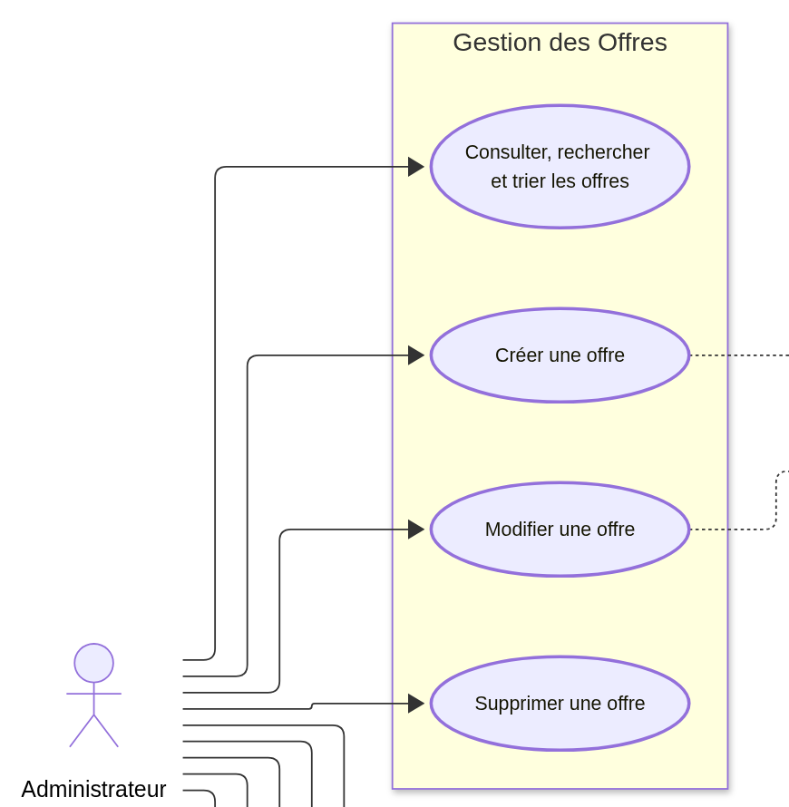
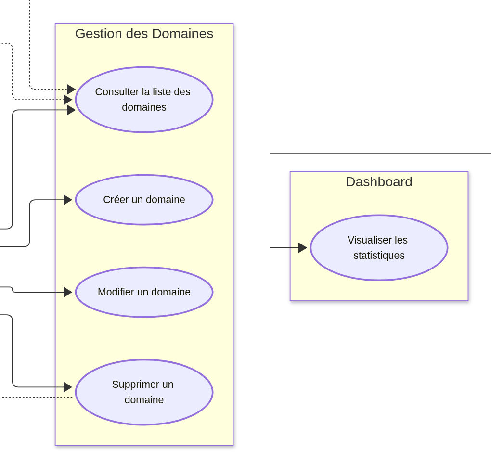
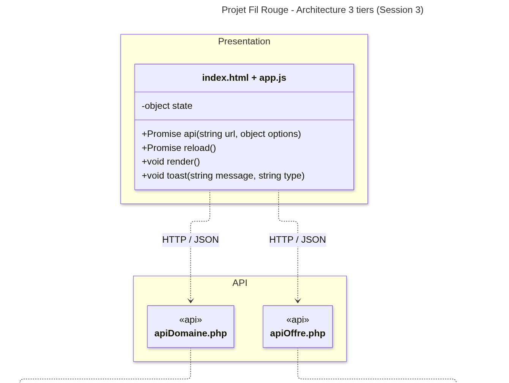
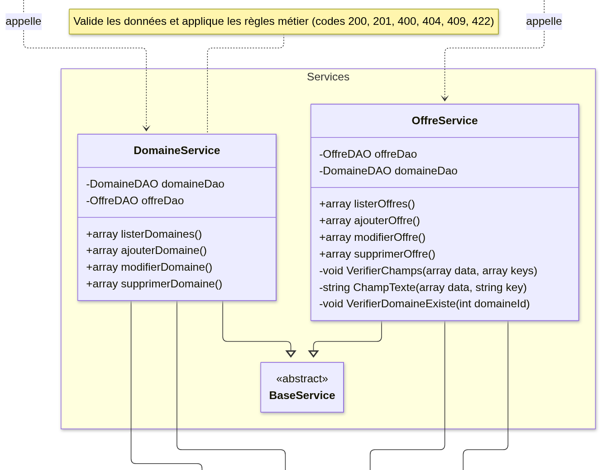
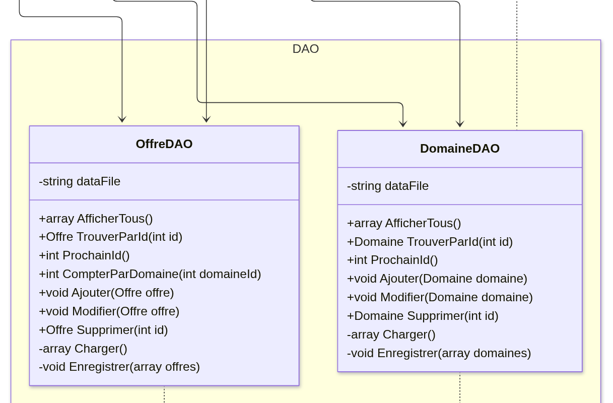
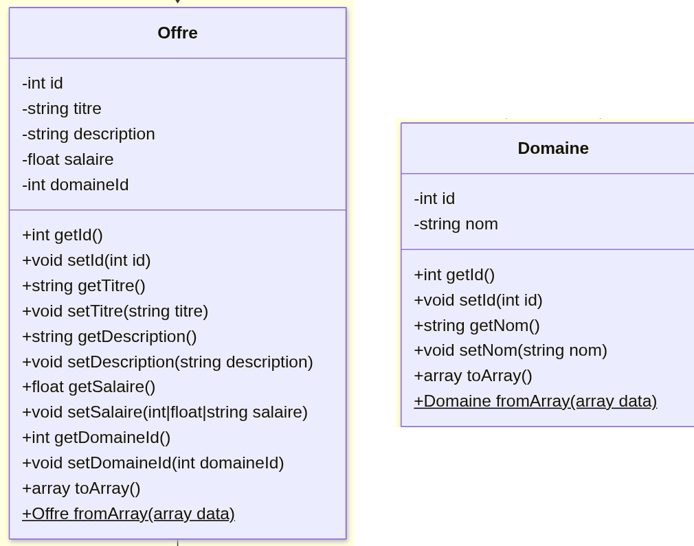
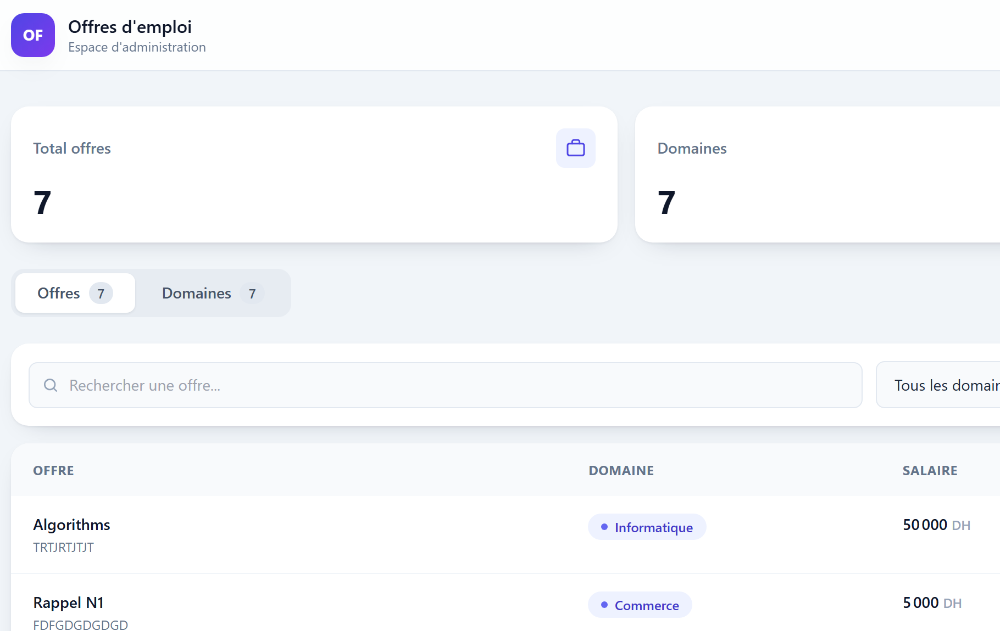
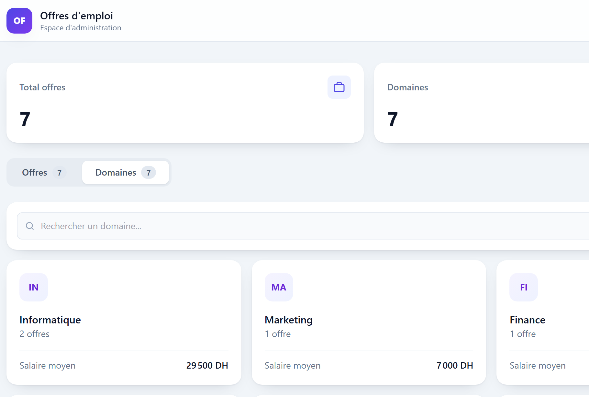
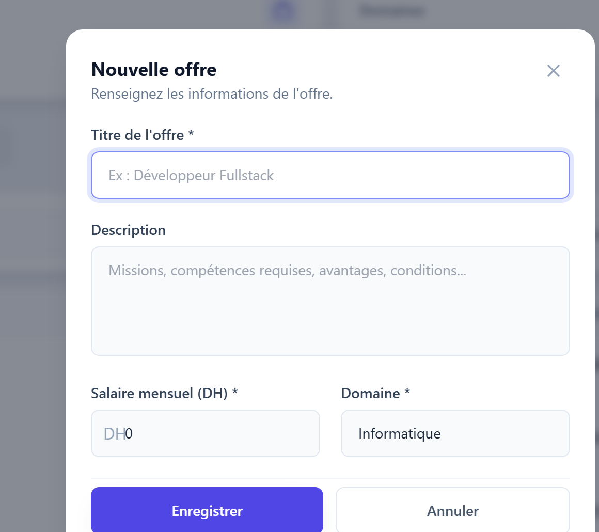

<!-- _class: title-slide -->
<!-- _paginate: false -->

Projet fil rouge · Développement Web

<h1>Projet Fil Rouge</h1>

Tableau de bord de gestion des offres d'emploi

Session
<strong>Session 3</strong>

Architecture
<strong>3 tiers &amp; patron DAO</strong>

---

## Sommaire

1. Contexte et objectifs du projet
2. Méthodologie : Scrum, 2TUP et Design Thinking
3. Planification et branche fonctionnelle
4. Conception technique : architecture, données et classes
5. Réalisation : maquettes
6. Bilan et perspectives

---

## Introduction

**Projet Fil Rouge — Offres d'emploi** est un tableau de bord d'administration qui centralise les offres d'emploi et leurs domaines. Exercice de **Session 3**, il applique une **architecture 3 tiers** et le **patron DAO**, sans framework et sans base de données, avec des fichiers **JSON**. L'application est fonctionnelle et testée sur <http://localhost:8000>.

---

## Contexte du projet

- Un point unique pour **consulter et administrer les offres**, classées par domaine.
- Le frontend parle **uniquement à l'API** : une seule couche (le DAO) lit et écrit les données.
- Pas de base de données → **fichiers JSON** ; pas de framework → **PHP 8.1+ et JavaScript natif**.
- Interface en **français**, sans authentification.
- **Règles de gestion** · une offre référence toujours un domaine existant ; un domaine rattaché à des offres est protégé.

---

<!-- _class: image-only -->
## Scrum

*Support à compléter : visuel de la méthode Scrum.*

---

<!-- _class: image-only -->
## Processus 2TUP

*Support à compléter : visuel du processus 2TUP.*

---

<!-- _class: image-only -->
## Design Thinking

*Support à compléter : visuel du Design Thinking.*

---

<!-- _class: compact -->
## Planification

*Planning des sprints à compléter.*

---

## Branche fonctionnelle

| Acteur | Besoins | Fonctions principales |
|---|---|---|
| **Administrateur** | Gérer les offres et les domaines depuis un point unique | Consulter, créer, modifier et supprimer les offres et les domaines |
| **Administrateur** | Suivre l'activité et retrouver une offre rapidement | Recherche, filtre par domaine, tri et statistiques |
| **Administrateur** | Garantir la cohérence du référentiel | Suppression d'un domaine protégée tant qu'il est rattaché à des offres |

**Périmètre livré** · CRUD complet des offres et des domaines, recherche, filtre, tri, statistiques et salaire moyen par domaine.

---

<!-- _class: compact -->
## Carte d'empathie

*Carte d'empathie à compléter.*

---

<!-- _class: statement -->
## Définition du problème

> Comment centraliser la gestion des offres d'emploi et de leurs domaines, avec une architecture 3 tiers et un accès aux données réservé au DAO ?

- **Besoin** · Un point unique pour consulter et administrer les offres, classées par domaine.
- **Contraintes** · Pas de base de données (JSON), pas de framework (PHP et JavaScript natifs), interface en français sans authentification.
- **Règles** · Une offre référence **toujours** un domaine existant ; un domaine rattaché à des offres est **protégé**.

---

<!-- _class: compact -->
## Idéation

*Idéation à compléter.*

---

<!-- _class: wide-image -->
## Diagramme de cas d'utilisation — Offres

- **Acteur unique : l'Administrateur** — **UC1** Consulter · **UC2** Créer · **UC3** Modifier · **UC4** Supprimer.

---

<!-- _class: wide-image -->
## Diagramme de cas d'utilisation — Domaines & Dashboard

- **UC5 à UC8** pour les domaines, **UC9** pour les statistiques — suppression d'un domaine lié bloquée (**409**).

---

## Stack technologique

- **Serveur** · PHP 8.1+ (sans framework)
- **Client** · JavaScript natif + HTML
- **Styles** · Tailwind CSS via CDN
- **Persistance** · JSON (`Domaines.json`, `Offres.json`)
- **Serveur local** · `php -S localhost:8000`
- **Diagrammes** · Mermaid → PNG (`Presentation/images/`)

---

## Prototype — Offres et Domaines

- **Modèles** · `Domaine`, `Offre` — getters/setters validés, `toArray()` / `fromArray()`
- **DAO** · `AfficherTous()`, `TrouverParId()`, `ProchainId()`, `Ajouter()`, `Modifier()`, `Supprimer()`
- **Services** · `lister…()`, `ajouter…()`, `modifier…()`, `supprimer…()`
- **API** · un fichier par entité, aiguillage par `REQUEST_METHOD`
- **Front** · `api()`, `reload()`, `render()`, `toast()` — `state` centralisé

---

## Relations des données

- **Domaine** → regroupe plusieurs offres ; il est **protégé** tant qu'il est référencé.
- **Offre** → rattachée à un domaine existant (clé étrangère `domaine_id`), sinon **422**.
- **Suppression** → un domaine lié à des offres ne peut pas être supprimé (**409**).

---

## Structure technique

- **Frontend** · `Projet/index.html` + `Projet/assets/js/app.js`
- **API** · `Projet/backend/api/` — `apiDomaine.php`, `apiOffre.php`
- **Services** · `Projet/backend/services/` — `BaseService`, `DomaineService`, `OffreService`
- **DAO** · `Projet/backend/dao/` — `DomaineDAO`, `OffreDAO`
- **Modèles** · `Projet/backend/classes/` — `Domaine`, `Offre`
- **Données** · `Projet/backend/data/` — `Domaines.json`, `Offres.json`

---

<!-- _class: split-left -->
## Diagramme de classes — Présentation & API

- **Présentation** · `Projet/index.html` + `app.js`
- **API** · un contrôleur par entité
- **Transport** · HTTP / JSON et codes 200 / 201 / 400 / 404 / 409 / 422

---

<!-- _class: wide-image -->
## Diagramme de classes — Services

- `DomaineService` et `OffreService` étendent `BaseService` : validation et **codes HTTP**.

---

<!-- _class: wide-image -->
## Diagramme de classes — DAO

- Seule couche à lire/écrire les JSON ; `CompterParDomaine()` déclenche le **409**.

---

<!-- _class: split-left -->
## Diagramme de classes — Modèles

- **Domaine** · identifiant, libellé
- **Offre** · titre, description, domaine, salaire
- **Relation** · `Offre` **n** ──▶ **1** `Domaine`

---

<!-- _class: gallery -->
## Maquettes

| Onglet Offres | Onglet Domaines |
|---|---|
|  |  |
| Liste des offres · recherche, filtre par domaine et tri | Référentiel des domaines · offres liées |

---

<!-- _class: split-left -->
## Interfaces

- Formulaires **modales** avec messages d'erreur **422**
- Confirmation avant suppression, **toasts** de retour
- États vides dédiés

---

<!-- _class: compact -->
## Réalisation — Back-end

| Couche | Réalisation |
|--------|-------------|
| **API** | `apiDomaine.php`, `apiOffre.php` — JSON + aiguillage HTTP |
| **Services** | Validation, règles métier, codes 200/201/400/404/409/422 |
| **DAO** | `Charger()` / `Enregistrer()`, `ProchainId()`, `CompterParDomaine()` |
| **Modèles** | `Domaine`, `Offre` — validation dans les setters |
| **Données** | 7 domaines et 7 offres au format JSON |

---

## Conclusion

- **Livré** · CRUD complet des offres et des domaines, recherche, tri, statistiques et salaire moyen par domaine.
- **Architecture maîtrisée** · Architecture 3 tiers et patron DAO effectivement respectés, API HTTP/JSON avec codes de statut corrects et messages en français.
- **À améliorer** · `BaseService` est vide : factoriser le code commun ; chemins relatifs dans les DAO → dépendre de la racine du projet.

**Merci de votre attention.**
