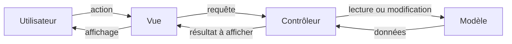
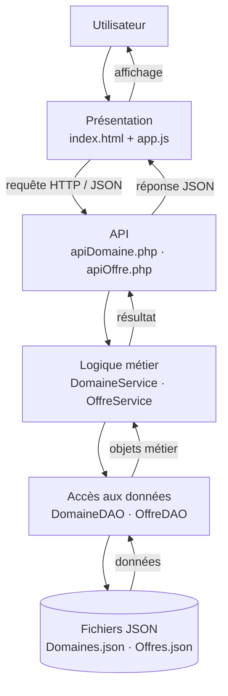
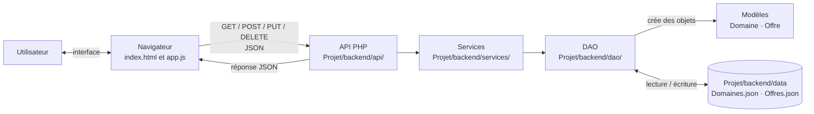

# Architecture du système
## Architecture MVC
Le modèle MVC répartit une application en trois rôles :
- **Modèle** : représente les données et les règles qui leur sont liées.
- **Vue** : affiche les informations et reçoit les actions de l’utilisateur.
- **Contrôleur** : reçoit une action, sollicite le modèle et transmet le résultat à la vue.

_Figure 1 — Échange MVC : le contrôleur coordonne la vue et le modèle lors d’une requête._
Dans le projet, MVC sert de **repère de compréhension**, mais n’est pas appliqué strictement : l’interface HTML/JavaScript est côté navigateur, tandis que les fichiers API et les services jouent les rôles de coordination. Les classes `Domaine` et `Offre` représentent les données métier.
## Architecture 3-tiers
Cette architecture sépare l'application en couches qui communiquent de proche en proche :
- **Présentation** : interface HTML/JavaScript ; envoie les requêtes et affiche les réponses.
- **Logique métier** : services et validation des données.
- **Accès aux données** : DAO et fichiers JSON.

_Figure 2 — Les trois tiers séparent l’interface, le traitement des opérations et le stockage._
## Architecture globale
Le projet permet de consulter, créer, modifier et supprimer des domaines et des offres. L’interface du navigateur communique avec les fichiers API PHP via `fetch`. Les données sont conservées dans des fichiers JSON ; elles ne sont pas stockées dans une base de données relationnelle.

_Figure 3 — Architecture commune aux versions du projet ; les noms des classes varient selon la version._
Le parcours d’une requête est le suivant :
1. `app.js` envoie une requête **GET** pour afficher les offres ou les domaines, **POST** pour créer, **PUT** pour modifier et **DELETE** pour supprimer.
2. `apiOffre.php` ou `apiDomaine.php` transmet l’opération au service, qui la valide puis appelle le DAO.
3. Le DAO lit ou met à jour le fichier JSON et renvoie des objets métier ; le service les convertit avec `toArray()`.
4. Le résultat est renvoyé au navigateur au format JSON ; l’interface affiche la liste actualisée et un toast de confirmation.
