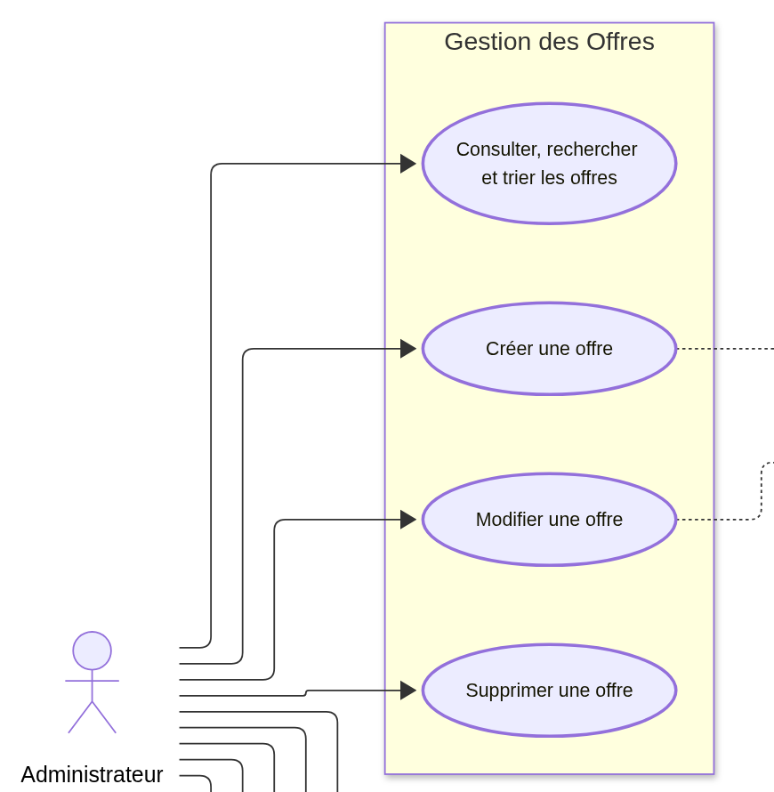
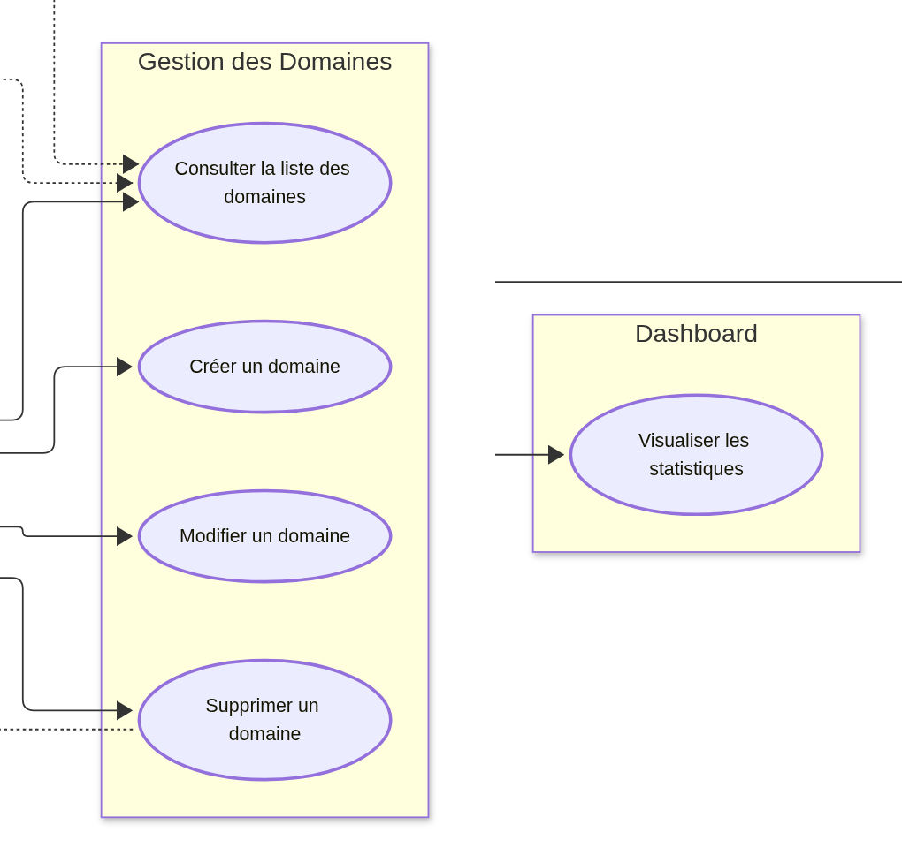
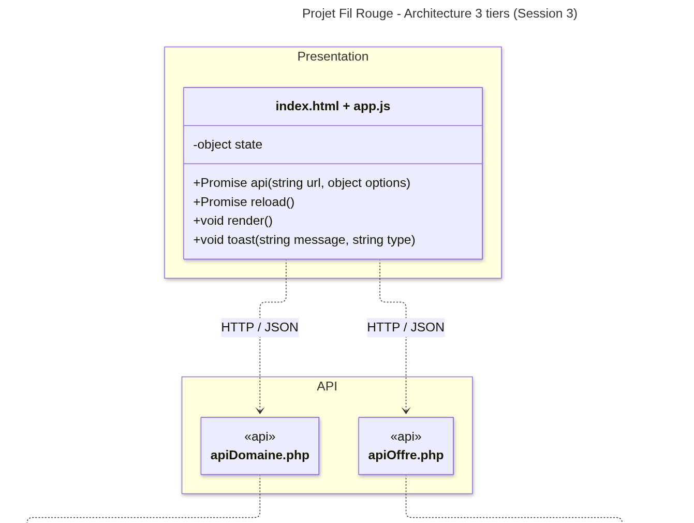
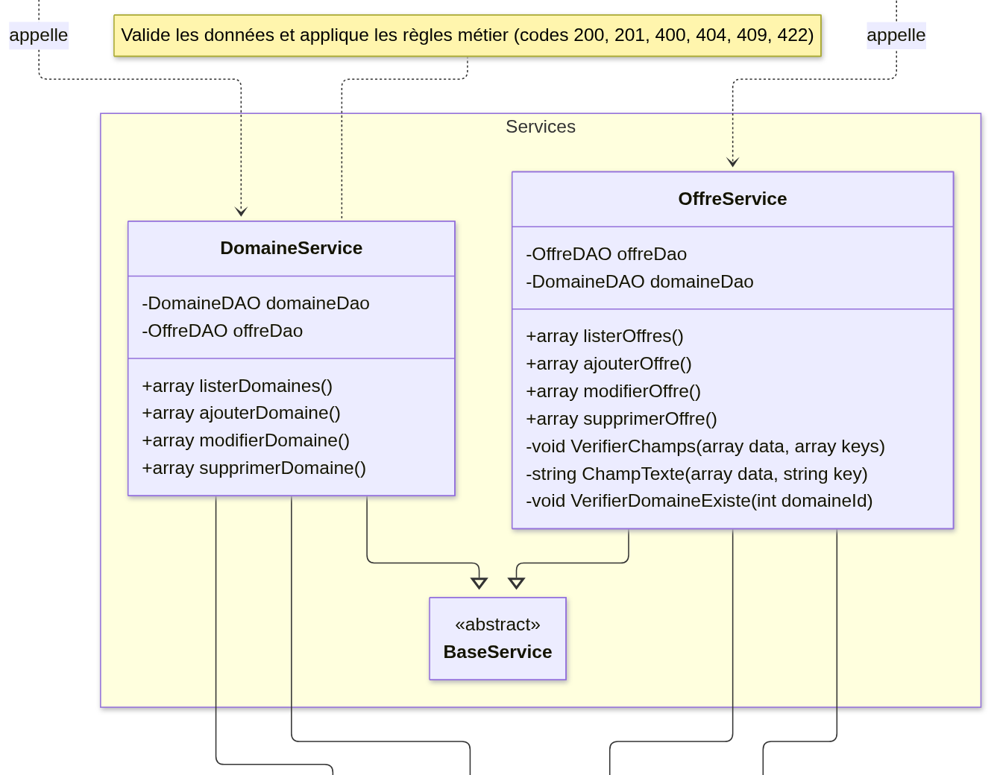
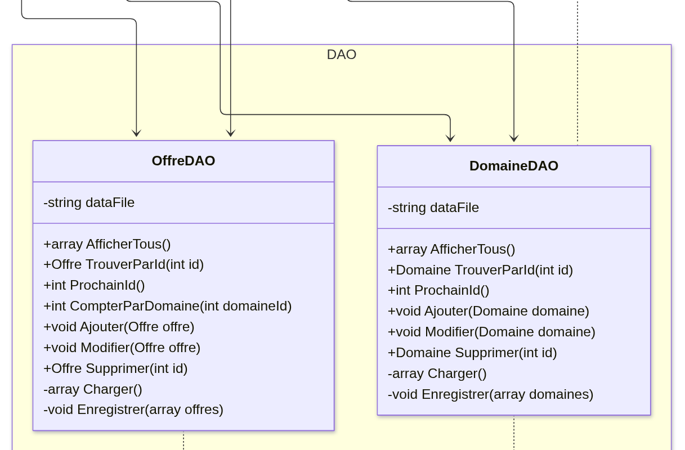
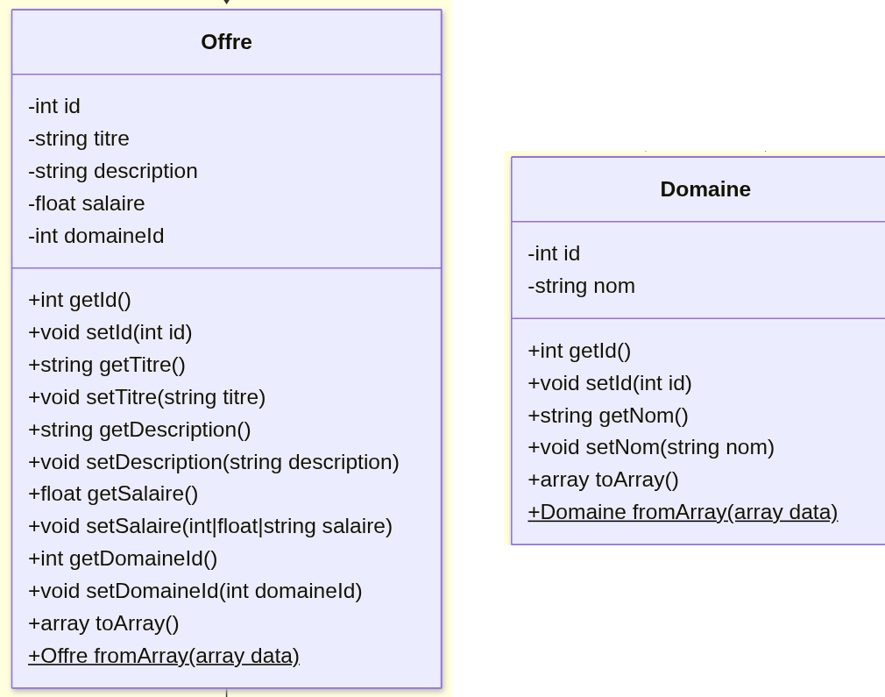
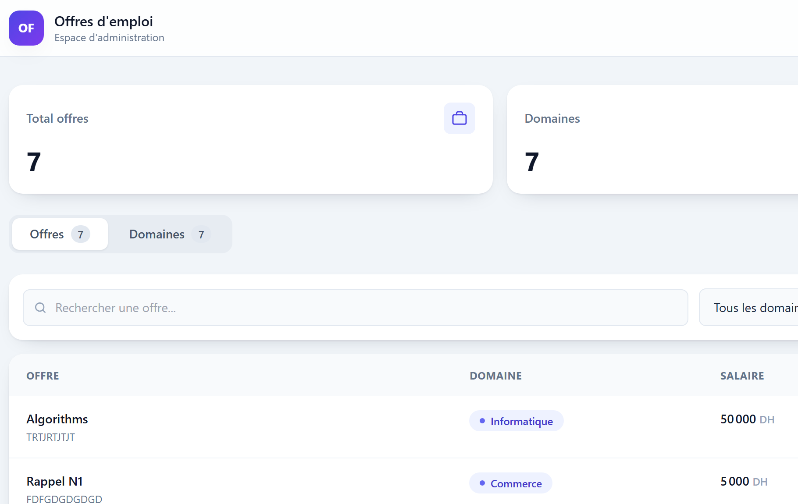
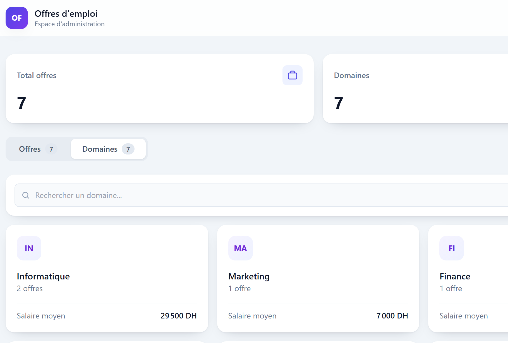
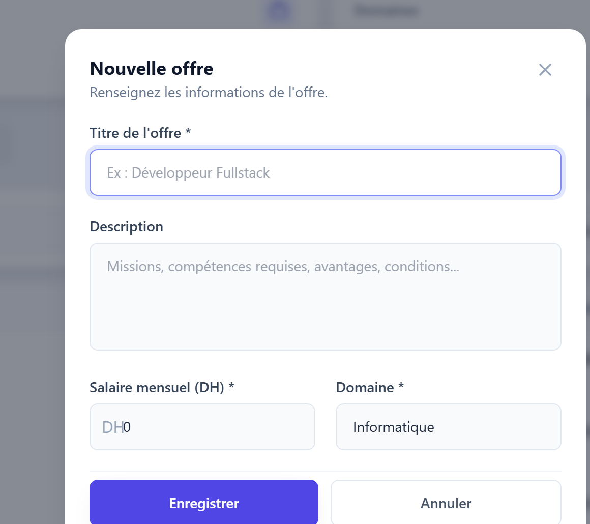

# Rapport du projet fil rouge
> **Note sur les sources :** ce rapport s'appuie sur le code source du dépôt et sur le cahier des charges de la Session 3. Il décrit l'application **Offres d'emploi** telle qu'elle est implémentée.

## Table des matières
- [Rapport du projet fil rouge](#rapport-du-projet-fil-rouge)
- [Table des matières](#table-des-matières)
- [Remerciements](#remerciements)
- [Introduction](#introduction)
- [Contexte du projet](#contexte-du-projet)
- [Objectif de formation (Solicode)](#objectif-de-formation-solicode)
- [Cahier des charges](#cahier-des-charges)
- [Méthodologie de travail](#méthodologie-de-travail)
- [Méthodologie Scrum](#méthodologie-scrum)
- [Sprint 1](#sprint-1)
- [Sprint 2](#sprint-2)
- [Processus 2TUP](#processus-2tup)
- [Design Thinking](#design-thinking)
- [Planification](#planification)
- [Branche fonctionnelle](#branche-fonctionnelle)
- [Carte d'empathie](#carte-dempathie)
- [Définition du problème](#définition-du-problème)
- [Idéation](#idéation)
- [Diagramme de cas d'utilisation](#diagramme-de-cas-dutilisation)
- [Branche technique](#branche-technique)
- [Stack technologique](#stack-technologique)
- [Architecture logicielle](#architecture-logicielle)
- [Prototype : fonctionnalités et classes](#prototype--fonctionnalités-et-classes)
- [Conception](#conception)
- [Diagramme de classes](#diagramme-de-classes)
- [Maquettes](#maquettes)
- [Réalisation](#réalisation)
- [Interfaces](#interfaces)
- [Conclusion](#conclusion)

## Remerciements

## Introduction

**Projet Fil Rouge — Offres d'emploi** est un tableau de bord d'administration qui centralise les offres d'emploi et leurs domaines. Réalisé en **Session 3**, il applique une **architecture 3 tiers** et le **patron de conception DAO**, sans framework et sans base de données relationnelle : les données sont conservées dans des fichiers **JSON**. L'application est fonctionnelle et se lance avec `php -S localhost:8000`.

## Contexte du projet

La gestion des offres d'emploi implique deux référentiels liés : les **domaines** (développement, design, marketing, etc.) et les **offres**, qui référencent toujours un domaine existant. Sans outil dédié, la consultation et la mise à jour de ces données deviennent rapidement coûteuses :

- les offres sont dispersées et difficiles à comparer ;
- les domaines ne sont pas structurés en un référentiel unique ;
- la suppression d'un domaine utilisé par des offres peut rendre les données incohérentes ;
- l'administrateur n'a aucune vue d'ensemble sur le volume d'offres et les salaires.

L'application répond à ce besoin avec un point unique pour **consulter, créer, modifier et supprimer** les offres et les domaines, ainsi qu'un tableau de bord statistique. Le frontend ne communique qu'avec l'API ; le DAO est la seule couche qui lit et écrit les fichiers JSON.

## Objectif de formation (Solicode)

- Maîtriser une **architecture 3 tiers** : présentation → API/services → DAO/modèles.
- Appliquer le **patron DAO** : une seule couche accède aux données.
- Programmer en **POO PHP** : classes, validation dans les setters, `toArray()` / `fromArray()`.
- Exposer une **API HTTP/JSON** avec des codes de statut normalisés.
- Construire une **interface web** responsive en JavaScript natif.

## Cahier des charges

| Exigence | Contenu |
|----------|---------|
| **Domaines** | CRUD complet (lister, afficher, créer, modifier, supprimer) |
| **Offres** | CRUD complet : titre, description, salaire, domaine associé |
| **Recherche et tri** | Recherche, filtre par domaine et tri côté client |
| **Interface** | Modales d'ajout / édition, confirmation avant suppression, toasts |
| **Statistiques** | Total des offres, total des domaines, salaire moyen par domaine |
| **Règles métier** | Une offre doit pointer vers un domaine existant (**422**) ; un domaine lié à des offres ne peut pas être supprimé (**409**) |

Contraintes techniques :

- **Serveur** : PHP 8.1+, sans framework.
- **Client** : JavaScript natif et HTML.
- **Styles** : Tailwind CSS via CDN.
- **Données** : fichiers JSON (`Domaines.json`, `Offres.json`), aucun SGBD.
- **Accès aux données** : le DAO uniquement.
- **API** : un fichier par entité, aiguillage par `REQUEST_METHOD`.
- **Messages** : en français, code **422** pour les données invalides.

## Méthodologie de travail

Le projet a été mené avec une démarche itérative : chaque itération ajoute un ensemble fonctionnel complet, de l'analyse des besoins jusqu'aux tests dans le navigateur.

### Méthodologie Scrum

Scrum est une méthode agile qui organise le travail en cycles courts et favorise la livraison progressive de fonctionnalités. Elle s'appuie sur trois principes :

- **Transparence** : rendre visibles les objectifs, les tâches et leur avancement.
- **Inspection** : examiner régulièrement le travail réalisé et les éventuels blocages.
- **Adaptation** : ajuster les priorités et le plan de travail à partir des résultats et des retours.

Le projet est organisé en sprints successifs. Chaque cycle permet de livrer un ensemble fonctionnel : les domaines et l'architecture ont d'abord été développés, puis les offres et les statistiques ont enrichi l'application.

*Figure 1 — Schéma de la méthode Scrum.*

#### Sprint 1

- Mise en place de l'architecture : modèles `Domaine` et `Offre`, DAO, services et fichiers API.
- CRUD complet des **domaines**.
- Diagrammes de cas d'utilisation.

#### Sprint 2

- CRUD complet des **offres** avec domaine associé.
- Recherche, filtre par domaine, tri et **statistiques** (salaire moyen par domaine).
- Modales, toasts, états vides et captures des interfaces.

### Processus 2TUP

2TUP (*Two Tracks Unified Process*) est une démarche itérative organisée autour de deux axes menés en parallèle :

- **Branche fonctionnelle** : compréhension des utilisateurs, des processus et des besoins métier.
- **Branche technique** : étude des contraintes, de l'architecture et des choix technologiques.

Les deux branches convergent vers la réalisation, qui comprend la conception, le développement, les tests et le déploiement. Le projet sépare effectivement les besoins fonctionnels — gestion des offres et des domaines, règles de suppression et de validation — des choix techniques — API HTTP/JSON, patron DAO et stockage dans des fichiers JSON — avant leur intégration dans l'application.

*Figure 2 — Schéma général du processus 2TUP.*

### Design Thinking

Le Design Thinking est une démarche de résolution de problèmes centrée sur les besoins des utilisateurs. Elle encourage la collaboration et l'exploration de solutions avant leur mise en œuvre.

Ses principales étapes sont :

1. **Empathie** : observer et interroger les utilisateurs pour comprendre leurs besoins et leurs difficultés.
2. **Définition** : synthétiser les informations recueillies et formuler le problème à résoudre.
3. **Idéation** : proposer plusieurs solutions possibles, sans écarter prématurément les idées.
4. **Prototype** : matérialiser une solution sous une forme simplifiée.
5. **Test** : recueillir les retours des utilisateurs et améliorer la solution.

*Figure 3 — Étapes du Design Thinking.*

## Planification

Le projet est découpé en deux itérations principales : la première pose l'architecture et le CRUD des domaines, la seconde ajoute les offres, les statistiques et les finitions de l'interface.

## Branche fonctionnelle

L'application ne comporte qu'un seul acteur, l'**Administrateur**, qui gère l'ensemble du référentiel depuis le tableau de bord.

### Carte d'empathie

> *Section à compléter.*

### Définition du problème

L'administrateur doit pouvoir gérer les offres d'emploi et leurs domaines depuis un point unique, sans risque d'incohérence entre les deux référentiels.

- **Besoin** : consulter et administrer les offres, classées par domaine.
- **Contraintes** : pas de base de données (JSON), pas de framework (PHP et JavaScript natifs), interface en français et sans authentification.
- **Règles de gestion** : une offre référence **toujours** un domaine existant ; un domaine rattaché à des offres est **protégé**.

### Idéation

Les solutions retenues découlent directement des contraintes du cahier des charges :

- **Architecture 3 tiers** avec un **patron DAO**, pour isoler l'accès aux données.
- **API HTTP/JSON** avec un fichier par entité et des codes de statut normalisés.
- **Validation dans les modèles** (setters) et dans les services, messages en français.
- **Interface modale** avec toasts et confirmation de suppression, sans rechargement de page.
- **Recherche, filtre et tri côté client**, sur un jeu de données chargé depuis l'API.
- **Statistiques** calculées à partir des offres et des domaines.

### Diagramme de cas d'utilisation

L'acteur unique, l'**Administrateur**, dispose de neuf cas d'utilisation : consultation, création, modification et suppression des offres (UC1 à UC4), gestion des domaines (UC5 à UC8) et consultation des statistiques (UC9).

*Figure 4 — Cas d'utilisation de la gestion des offres.*

*Figure 5 — Cas d'utilisation des domaines et du tableau de bord.*

## Branche technique

### Stack technologique

Le dépôt permet d'identifier les choix techniques suivants :

- **Backend** : PHP 8.1 ou supérieur, en programmation orientée objet, sans framework.
- **API** : un fichier par entité (`apiDomaine.php`, `apiOffre.php`), réponses JSON et méthodes HTTP GET, POST, PUT et DELETE.
- **Architecture** : trois tiers — présentation, services, DAO — avec un modèle POO par entité.
- **Stockage des données** : fichiers JSON (`Domaines.json`, `Offres.json`) lus et écrits par les DAO.
- **Frontend** : HTML5, Tailwind CSS chargé via CDN, JavaScript natif et Fetch API, sans framework ni étape de compilation.
- **Authentification** : aucune ; l'interface est ouverte et en français.
- **Diagrammes** : Mermaid, exporté en PNG.
- **Versionnement** : Git.

### Architecture logicielle

L'application est organisée en trois tiers, eux-mêmes subdivisés en quatre ensembles de fichiers :

1. **Présentation** (`index.html` et `assets/js/app.js`) : interface, onglets Offres et Domaines, modales, recherche, tri et statistiques. Le fichier `app.js` centralise les appels HTTP dans une fonction `api()` et un état `state`.
2. **API** (`backend/api/`) : `apiDomaine.php` et `apiOffre.php` aiguillent la requête selon `REQUEST_METHOD` et appellent la méthode correspondante du service.
3. **Logique métier** (`backend/services/`) : `DomaineService` et `OffreService` valident les données, appliquent les règles métier et positionnent les codes HTTP (200, 201, 400, 404, 409, 422).
4. **Accès aux données** (`backend/dao/` et `backend/classes/`) : `DomaineDAO` et `OffreDAO` lisent et écrivent les fichiers JSON ; `Domaine` et `Offre` sont les modèles POO.

Le frontend et le backend sont séparés : toutes les pages passent par l'API, sans accès direct aux fichiers de données. Les services ne manipulent que des objets métier ; seuls les DAO connaissent le format JSON.

Exemple de flux : l'interface appelle `GET apiOffre.php?id=1` ; `apiOffre.php` transmet la requête à `OffreService::listerOffres()` ; le service interroge `OffreDAO::TrouverParId()` ; l'offre lue dans `Offres.json` est convertie par `Offre::fromArray()`, puis renvoyée en JSON et affichée par `app.js`.

### Prototype : fonctionnalités et classes

Le prototype implémenté est le tableau de bord **Offres d'emploi**. Il couvre la gestion complète des deux entités.

Fonctionnalités réalisées :

- CRUD complet des **domaines** ;
- CRUD complet des **offres**, avec titre, description, salaire et domaine associé ;
- recherche, filtre par domaine et tri côté client ;
- modales d'ajout et d'édition, confirmation avant suppression et toasts de retour ;
- statistiques : total des offres, total des domaines et salaire moyen par domaine ;
- états vides dédiés pour chaque onglet.

Classes et relations :

- `Domaine` : identifiant entier positif et nom obligatoire ; validation dans les setters ; `toArray()` et `fromArray()`.
- `Offre` : identifiant, titre obligatoire, description optionnelle, salaire numérique positif et `domaine_id` obligatoire ; validation dans les setters.
- `DomaineDAO` : `AfficherTous()`, `TrouverParId()`, `ProchainId()`, `Ajouter()`, `Modifier()`, `Supprimer()`, plus `Charger()` et `Enregistrer()` privés.
- `OffreDAO` : les mêmes opérations, avec en plus `CompterParDomaine()`.
- `DomaineService` et `OffreService` héritent de `BaseService` et portent les règles métier : validation, existence du domaine, protection à la suppression.
- `BaseService` est une classe abstraite, encore vide, destinée à factoriser le code commun.

Relations :

- une `Offre` est rattachée à un `Domaine` via `domaine_id` (relation **n → 1**) ;
- un `Domaine` peut regrouper plusieurs `Offre` ;
- la suppression d'un domaine utilisé est refusée avec le code **409**, en s'appuyant sur `OffreDAO::CompterParDomaine()`.

## Conception

### Diagramme de classes

Les diagrammes décrivent les quatre ensembles du système : la présentation et l'API, les services, le DAO et les modèles.

*Figure 6 — Couches Présentation et API.*

*Figure 7 — Couche Services : `DomaineService` et `OffreService` étendent `BaseService`.*

*Figure 8 — Couche DAO : seule couche à lire et écrire les fichiers JSON.*

*Figure 9 — Modèles `Offre` et `Domaine`, reliés par `domaine_id`.*

### Maquettes

*Figure 10 — Onglet Offres : recherche, filtre par domaine et tri.*

*Figure 11 — Onglet Domaines : référentiel et nombre d'offres liées.*

## Réalisation

### Interfaces

*Figure 12 — Modale d'ajout d'une offre avec sélection du domaine.*

L'interface applique les règles métier côté client tout en laissant le serveur décider :

- les formulaires sont présentés dans des **modales** ; les erreurs de validation **422** sont affichées dans la modale ;
- une **confirmation** est demandée avant chaque suppression ;
- les opérations réussies ou refusées déclenchent un **toast** ;
- la suppression d'un domaine utilisé renvoie un message explicite (**409**), affiché tel quel.

Côté back-end, la réalisation se répartit ainsi :

| Couche | Réalisation |
|--------|-------------|
| **API** | `apiDomaine.php`, `apiOffre.php` — en-tête JSON et aiguillage HTTP |
| **Services** | Validation, règles métier, codes 200/201/400/404/409/422 |
| **DAO** | `Charger()` / `Enregistrer()`, `ProchainId()`, `CompterParDomaine()` |
| **Modèles** | `Domaine`, `Offre` — validation dans les setters |
| **Données** | 7 domaines et 7 offres au format JSON |

## Conclusion

Le prototype est fonctionnel : le CRUD des offres et des domaines, la recherche, le tri et les statistiques sont opérationnels, et l'architecture 3 tiers comme le patron DAO sont effectivement respectés. Le frontend ne parle qu'à l'API, les services portent les règles métier et le DAO est la seule couche à manipuler les fichiers JSON. L'API renvoie des codes de statut corrects avec des messages en français.

Pistes d'amélioration :

- `BaseService` est vide : y factoriser la lecture du corps JSON et la validation commune.
- Les DAO utilisent des chemins relatifs (`../data/…`) : les faire dépendre de la racine du projet pour éviter toute dépendance au répertoire courant.
- Ajouter une authentification et une pagination si le volume d'offres augmente.
